**[MasterGate Viewer](https://mastergate.io/viewer/) is a free third-party viewer for Second Life with the MasterGate phone (MG Phone) built in.**

This repository contains its full source code. MasterGate Viewer is made by [MasterGate](https://mastergate.io) and based on [Firestorm](https://github.com/FirestormViewer/phoenix-firestorm) and the [Second Life viewer](https://github.com/secondlife/viewer). It is **not provided or supported by Linden Lab** or by The Phoenix Firestorm Project.

<br clear="left"/>

<p align="center">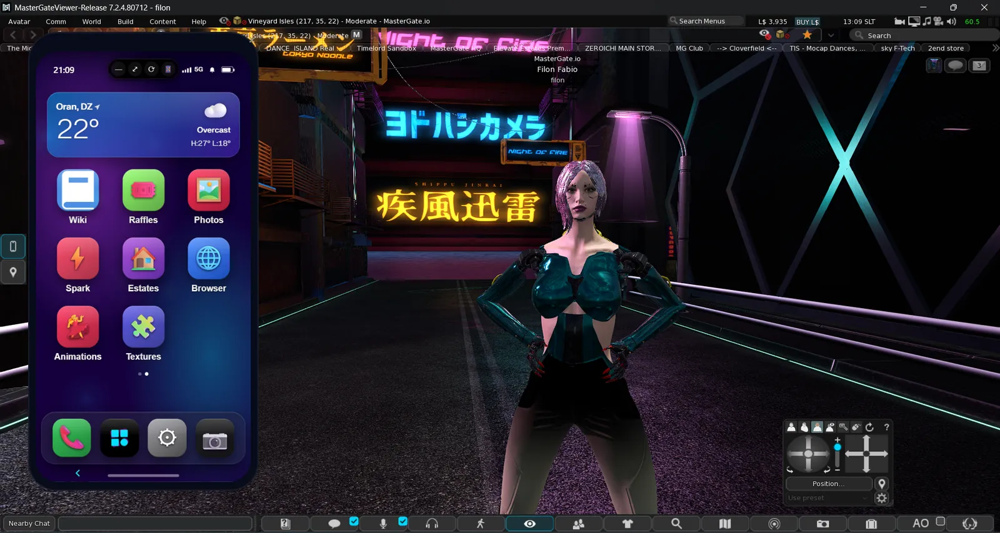</p>

## Download

Windows, macOS (beta) and Linux (beta): **https://mastergate.io/viewer/**. The packages are also attached to the [releases](../../releases) here, with SHA-256 checksums.

Installing over an older version keeps your settings. When a new release is out, the viewer offers the update itself.

## What's new in 7.2.5

- **Firestorm 7.2.5.** The viewer is now based on Firestorm 7.2.5, with all its fixes and features.
- **Places** (new app): your landmarks as places, with the parcel picture, region, maturity rating, traffic and distance.
  - Folders shown as picture mosaics, favorites, the teleport history, and the place you are in, saved in one tap.
  - **Tidy up** finds exact copies, landmarks at the same spot and places that no longer exist.
  - Share a landmark with a friend, someone nearby or any resident.
- **Destinations**: a tab in Places with the places residents vote for through MasterGate Pulse. Ranked, by category, with the people there right now; teleport in one tap.
- **AO in the Animations app.** Manage the whole AO from the phone: sets, states, order, cycling, sit options, and animations added straight from your library.
- **A cleaner look.** Solid navigation bar, dark script dialogs and a cyan avatar loading cloud. The favorites bar is gone: Places keeps your landmarks.
- **Lighter notifications.** No checks while the phone is open, and fewer while you are away.

## MasterGate Viewer and Firestorm

Everything Firestorm does is still here. MasterGate Viewer adds:

| | Firestorm | MasterGate Viewer |
|---|---|---|
| Phone | – | **MG Phone** built in as a panel: no HUD to wear, no script memory, no screen space lost |
| MasterGate account | – | signed in automatically at login; notifications appear as viewer toasts |
| Voice calls | the call window | calls ring and run in the phone; contacts, nearby, recents and favorites |
| Photography | snapshot floater | **Camera Pro**: framing guides, exposure, time of day, looks, an editor, posting to Photos |
| Textures & materials | inventory names | **a photo library** of your textures and PBR materials; preview, apply, edit, organize |
| Animations | inventory names, AO floater | **a 3D stage** with a mannequin; playlists; the whole AO managed from the phone |
| Clothing | inventory names | **Wardrobe**: picture cards and outfits, each item viewable in 3D before you wear it |
| Landmarks | landmarks floater, favorites bar | **Places**: pictures, ratings, folders, history, clean-up, sharing, Destinations |
| Apps | – | the MasterGate apps (Feeds, AvaTalk, Vortex, Photos, LandLord, Pulse BI, MasterAds, Wallet…) and an App Store |
| Look | Firestorm skins | the dark MasterGate skin |

<table>
  <tr>
    <td align="center">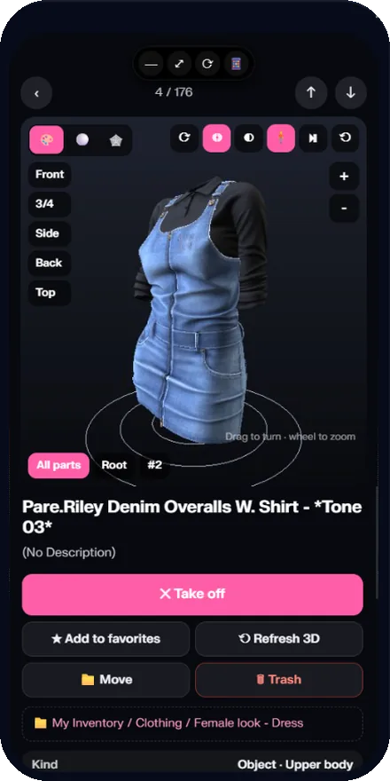<br/><b>Wardrobe 3D</b></td>
    <td align="center">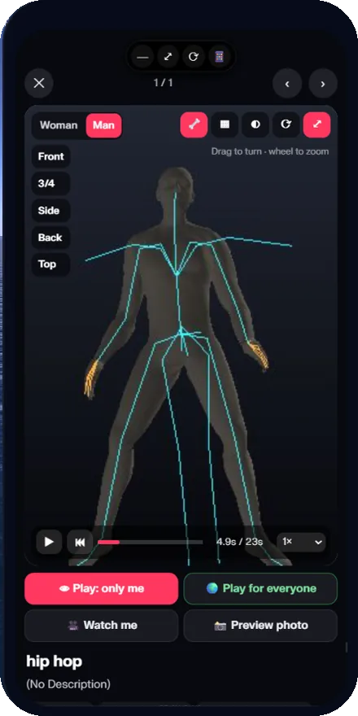<br/><b>Animations</b></td>
    <td align="center">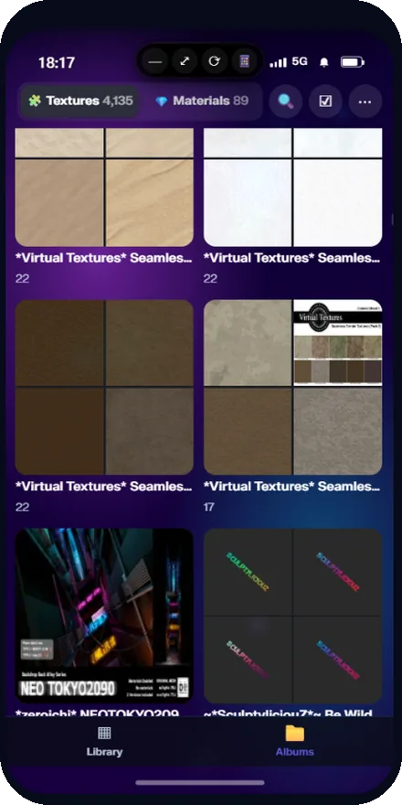<br/><b>Textures</b></td>
    <td align="center">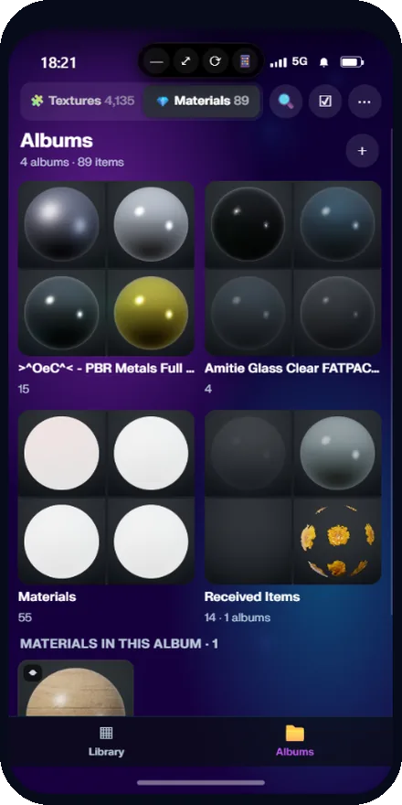<br/><b>Materials</b></td>
  </tr>
  <tr>
    <td align="center">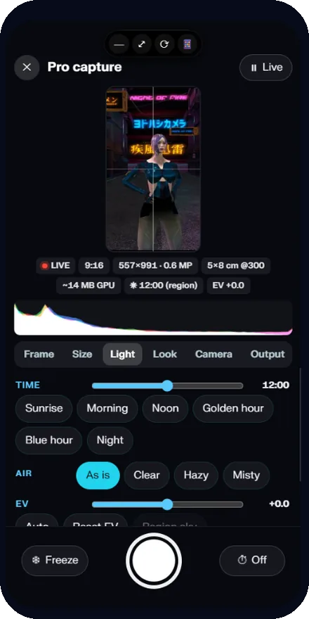<br/><b>Camera Pro</b></td>
    <td align="center">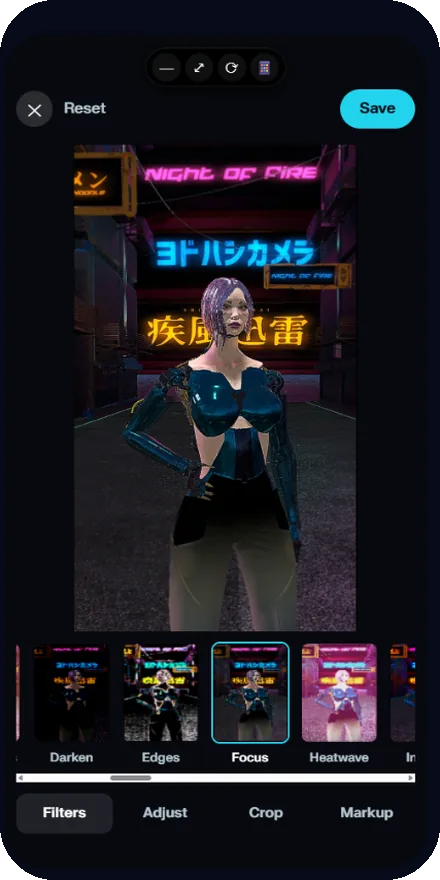<br/><b>Photo editor</b></td>
    <td align="center">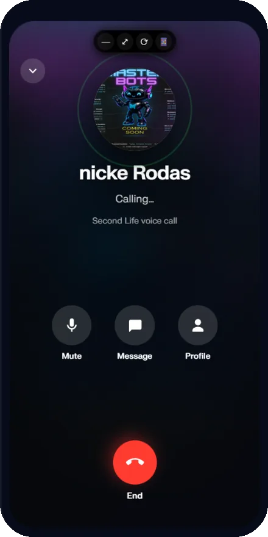<br/><b>Calls</b></td>
    <td align="center">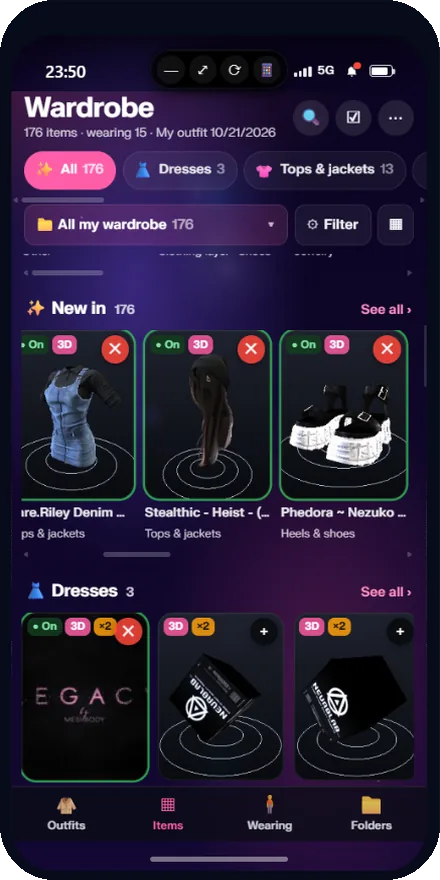<br/><b>Wardrobe</b></td>
  </tr>
  <tr>
    <td align="center">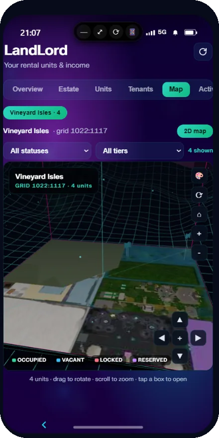<br/><b>LandLord</b></td>
    <td align="center">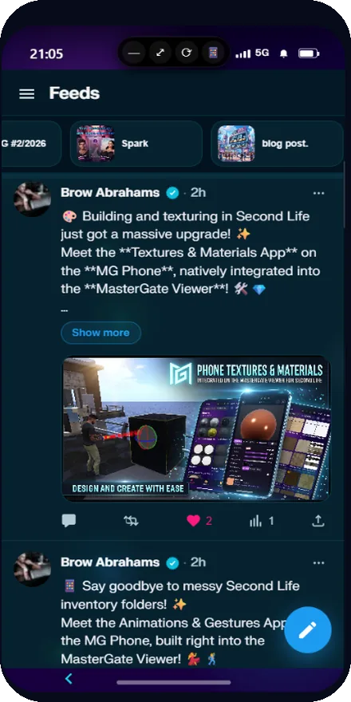<br/><b>Feeds</b></td>
    <td align="center">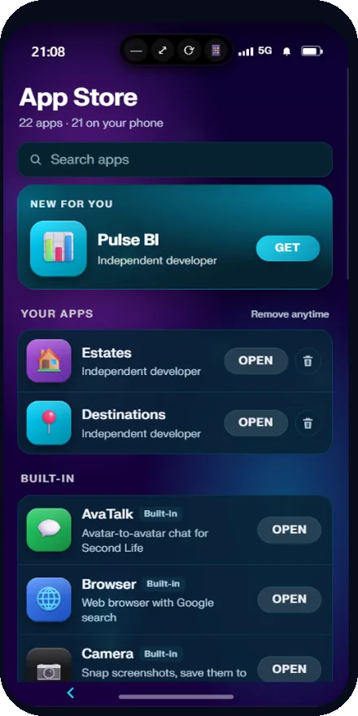<br/><b>App Store</b></td>
    <td></td>
  </tr>
</table>

Phone pages never receive asset UUIDs: thumbnails and 3D views are rendered by the viewer. See the [privacy policy](https://mastergate.io/viewer/privacy/) for what the phone sends to mastergate.io.

## Build apps for the MG Phone

Every app on the MG Phone is a web page, so anyone can build one. The same app runs in MasterGate Viewer, in the MG Phone HUD in any viewer, and on the web.

- **Any stack.** Plain HTML/JS, React, Vue or Svelte for the page; PHP, Node.js, Python, Go or no backend at all.
- **The SDK** is one script. It signs the member in, so your app knows their name, avatar and id with one call.
- **Storage and notifications.** A private key/value store per app and per member; notifications pushed to the member's phone.
- **In-world bridge.** Connect your app to the products members own in Second Life, as a clean app instead of a worn HUD.
- **Sandbox, review, App Store.** Preview the app in a real phone, submit it for review, then publish it for every member.

```html
<script src="https://mastergate.io/sdk.js"></script>
<script>
(async () => {
  const mg = MGOS.init();
  if (!mg.isAuthenticated()) return;      // opened outside the phone
  const me = await mg.whoami();           // { uuid, name, avatar_url }
  await mg.kv.set('last_seen', Date.now());
  await mg.notify('Welcome back', me.name);
})();
</script>
```

- Developer guide: **https://mastergate.io/developers/guide**
- Developer Portal (register an app, get an API key, live sandbox): **https://mastergate.io/developers**
- Example app: **https://mastergate.io/developers/example**

## Inside the viewer (for viewer developers)

- **Branch `mastergate/main`**, merged with Firestorm's release tag `Firestorm_Release_7.2.5.81788`.
- **Where the MasterGate code is:** new files (`indra/newview/mg*.cpp`, `mg*.h`), or edits in Firestorm files marked `<MG>` … `</MG>`. Firestorm releases can therefore be merged in.
- **The phone panel** (`mgfloaterphone.cpp`, `floater_mg_phone.xml`) hosts the MG Phone web shell in a phone-shaped window and scales the page into it.
- **The native bridge** is open only to the phone's own top document, so third-party apps use the SDK above.
  - The page calls `MGOSNative.send(cmd, args)`, which returns a promise. It listens with `MGOSNative.on(fn)` for events pushed by the viewer.
  - Each app module owns a command prefix:

| File | Commands | App |
|---|---|---|
| `mgfloaterphone.cpp` | `hello`, `state`, `notify`, `say`, `im`, `openurl`, `teleport`, `snapshot`, `camera_*` | the panel, chat, IMs, teleport by SLURL, snapshots |
| `mgphoneauth.cpp` | (no commands) | automatic sign-in, notification toasts |
| `mgphonecalls.cpp` | `call_*` | voice calls in the phone |
| `mgphonecamera.cpp` | `cam_*` | Camera Pro capture |
| `mgphoneinventory.cpp` | `inv_*` | Textures & Materials, shared inventory commands |
| `mgphoneanims.cpp` | `anim_*`, `gest_*` | Animations, the 3D stage, the AO |
| `mgphonewardrobe.cpp` | `ward_*` | Wardrobe and its 3D view |
| `mgphoneplaces.cpp` | `place_*` | Places |
| `mgphoneupdate.cpp` | `update_*` | in-viewer updates (Windows) |

- **The interface skin** is `indra/newview/skins/mastergate`.
- **Endpoints** are settings, not hard-coded: `MGPhoneURL` (the phone) and `MGPhoneAuthURL` (sign-in and notifications).

## Building

Follow Firestorm's build instructions for [Windows](doc/building_windows.md), [macOS](doc/building_macos.md) and [Linux](doc/building_linux.md), with the open-source configuration (OpenAL audio, no FMOD):

```
autobuild configure -A 64 -c ReleaseFS_open -- --chan Release --no-opensim
autobuild build -A 64 -c ReleaseFS_open --no-configure
```

- Add `--package` to the configure options to produce the installer.
- The version's last number comes from `indra/newview/MGV_REVISION.txt`.
- [`.github/workflows/mastergate_build.yml`](.github/workflows/mastergate_build.yml) builds all three platforms on GitHub. A `mgv-<version>` tag also drafts a release.

Self-compiled builds are not supported. Please use the official downloads.

## Support

Open a ticket at **https://mastergate.io/m/ticket/add**, or use Help in the viewer. Please do not ask Linden Lab or the Firestorm team for help with MasterGate Viewer.

## License and credits

- The viewer code is available under the **GNU LGPL 2.1** ([LICENSE](doc/LGPL-license.txt)), like the Second Life and Firestorm viewers it is based on.
- Thanks to Linden Lab and to The Phoenix Firestorm Project and its contributors, whose work this viewer builds on.
- Second Life is a trademark of Linden Research, Inc. Firestorm is a project of The Phoenix Firestorm Project, Inc.
- MasterGate and the MasterGate Viewer name and logo belong to MasterGate.
- This viewer follows Linden Lab's [Policy on Third-Party Viewers](https://secondlife.com/corporate/third-party-viewers).
